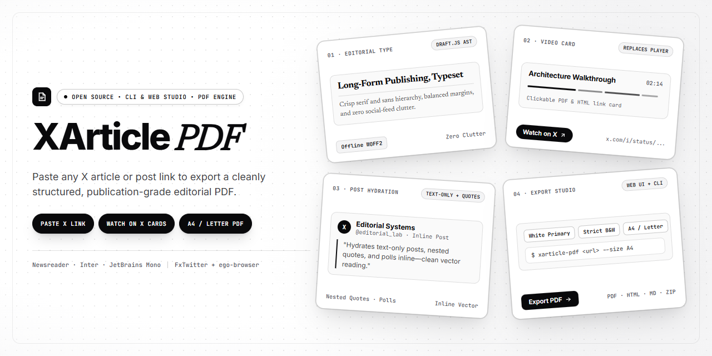

# XArticle PDF



> **Repository:** [`Fazzbro/xarticle-pdf`](https://github.com/Fazzbro/xarticle-pdf)

Export X (Twitter) Articles into cleanly structured, publication-grade PDFs directly from pasted links—via a monochrome **Web Studio** or scriptable **CLI**.

## Features

- **Monochrome Print & Studio Layout**: Paper White primary workspace with toggleable Obsidian Black mode, live print preview (`Fit`, `85%`, `100%`), single or batch URL extraction, multi-PDF `.zip` archives, and standalone HTML / Markdown export.
- **Scriptable CLI (`xarticle-pdf`)**: Export single X links or batch lists (`--file <urls.txt>`) straight to `./exports`.
- **Dual-Layer Extraction**: Fast structured Draft.js AST extraction via the FxTwitter API, with automatic `ego-browser` fallback for `/i/article/` or login-gated articles.
- **Supported Links**: `x.com/<user>/status/<id>`, `x.com/<user>/article/<id>`, `x.com/i/article/<id>`, `twitter.com`, `fxtwitter.com`, `fixupx.com`, `vxtwitter.com`, and `fixvx.com`.
- **In-Place `Watch on X` Video Cards**: Replaces raw video players and animated GIFs in-place with clickable **Watch on X** link cards (plus optional static poster thumbnails via `--video-poster`).
- **Text-Only & Rich Embedded Post Hydration**: Hydrates embedded X posts inline—including text-only posts without images, nested quote posts, polls, link cards, and image grids.
- **Editorial Typography & Print Controls**: Bundled offline WOFF/WOFF2 fonts (`Newsreader`, `Inter`, `JetBrains Mono`), `editorial` / `sans` / `technical` presets, `light` / `ivory` / `dark` paper modes, `A4` / `Letter` sizing, `compact` / `balanced` / `generous` margins, optional Table of Contents, running headers/footers, and clickable vector link annotations.
- **Website & Serverless Ready (Netlify)**: Deploys cleanly as a public web app via [`netlify.toml`](netlify.toml) and `netlify/functions/*` (`health`, `extract`, SSRF-guarded `media-proxy`), generating instant browser preview, HTML, Markdown, and downloadable clickable vector PDFs/ZIPs directly in the browser without requiring headless Chromium on the server.

## Deploy as Website (Netlify)

This repository includes zero-config Netlify support via [`netlify.toml`](netlify.toml):

- **Build command:** `npm run build`
- **Publish directory:** `dist/web`
- **Functions directory:** `netlify/functions` (mapped cleanly from `/api/*` via Netlify redirects)

Push updates to your connected GitHub branch and Netlify automatically builds the static Web Studio and serverless extraction functions.

## Setup

### Prerequisites

- **Node.js** (v20+ recommended)
- **Local Chromium-based browser** (Google Chrome or Microsoft Edge) for headless PDF generation via `playwright-core`. If installed in a non-standard location, set `CHROMIUM_PATH` or `PLAYWRIGHT_CHROMIUM_EXECUTABLE_PATH`.
- **Ego Lite Browser (`ego-browser`)** *(optional)*: Used automatically when `--no-browser` is not passed and browser fallback is needed for gated or `/i/article/` links.

### Install

```bash
git clone https://github.com/Fazzbro/xarticle-pdf.git
cd xarticle-pdf
npm install
```

## Usage

### Web Studio

Start the development server (runs at `http://127.0.0.1:3456` by default; configurable via `HOST` and `PORT`):

```bash
npm run dev
```

Or build and run the production server:

```bash
npm run build
npm start
```

Open `http://127.0.0.1:3456`, paste one or more X article links, adjust typography and print layout options in the live preview, and click **Export PDF**.

### CLI

Run directly with `tsx` during development:

```bash
npm run cli -- https://x.com/<user>/status/<id> --out ./exports --theme editorial --size A4
```

Or after building (`npm run build`), run `dist/cli.js` / `xarticle-pdf`:

```bash
node dist/cli.js --file urls.txt --out ./exports --theme editorial --paper light --size A4 --margins balanced --toc --markdown
```

#### CLI Options

| Option | Values / Default | Description |
| --- | --- | --- |
| `--file <urls.txt>` | — | Read X/Twitter URLs from a file |
| `--out <dir>` | `./exports` | Output directory |
| `--theme <preset>` | `editorial` \| `sans` \| `technical` (`editorial`) | Typography preset |
| `--paper <preset>` | `light` \| `ivory` \| `dark` (`light`) | Paper color scheme |
| `--size <preset>` | `A4` \| `Letter` (`A4`) | PDF page size |
| `--margins <preset>` | `compact` \| `balanced` \| `generous` (`balanced`) | Page margins (`14mm` / `18mm` / `22mm`) |
| `--toc` | `false` | Include Table of Contents |
| `--video-poster` | `false` | Include static video thumbnail beside video link |
| `--stats` | `false` | Include likes/reposts/views strip |
| `--markdown` | `false` | Also save `.md` alongside `.pdf` |
| `--no-browser` | `false` | Disable `ego-browser` fallback |
| `--help`, `-h` | — | Show CLI help |

## Tests & Verification

```bash
npm run typecheck
npm test
npm run build
```
